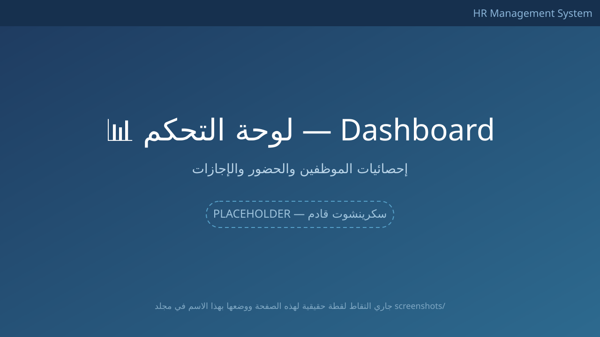
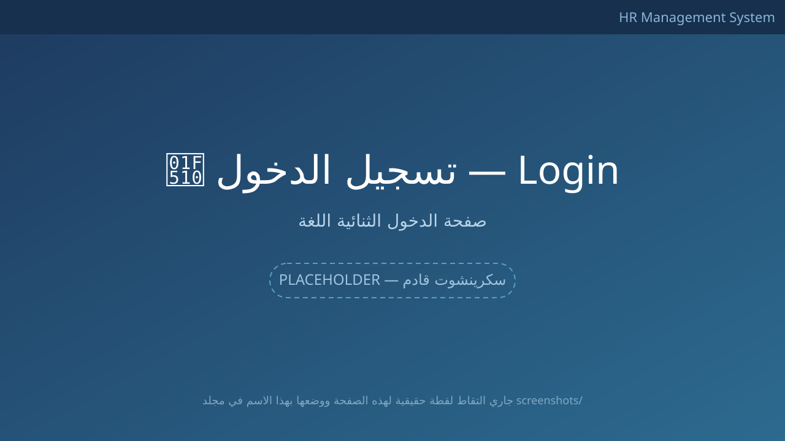
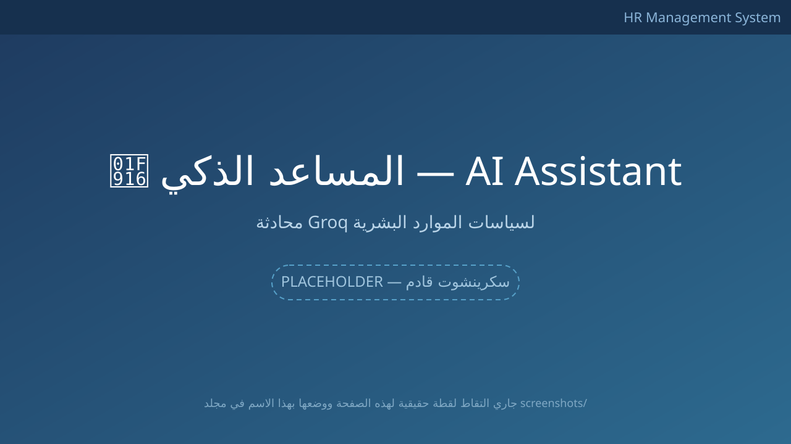
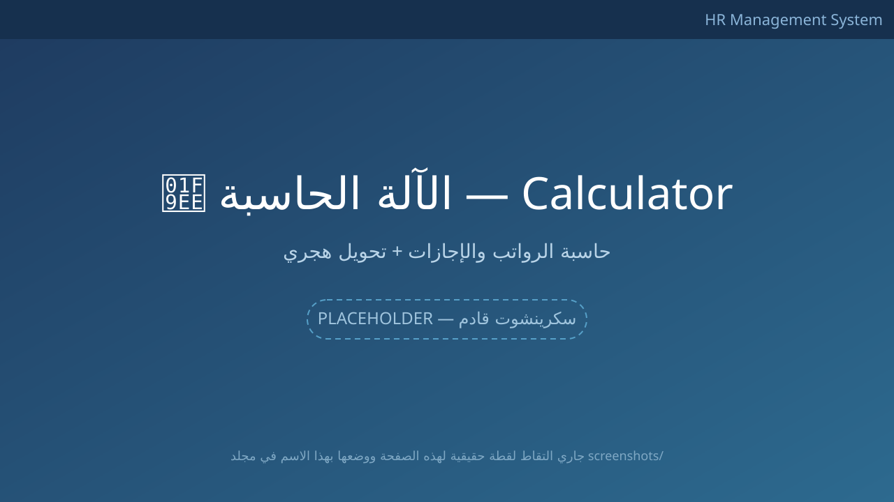
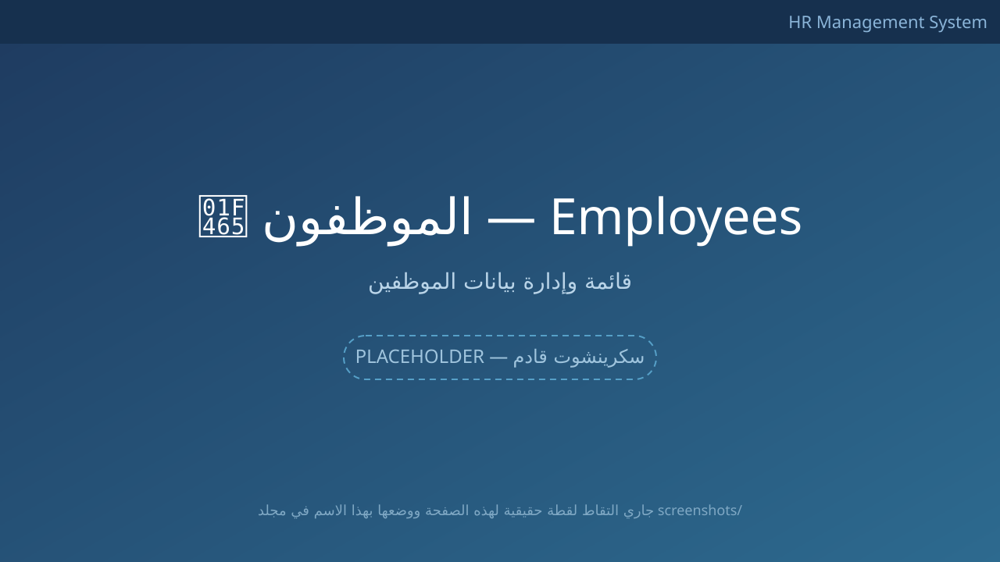
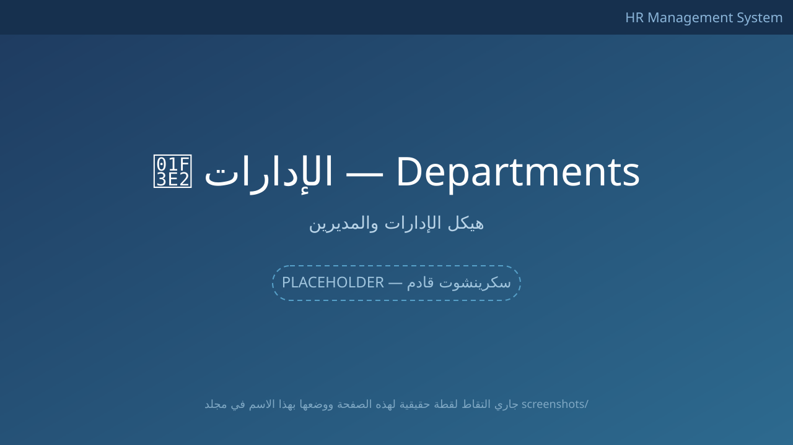
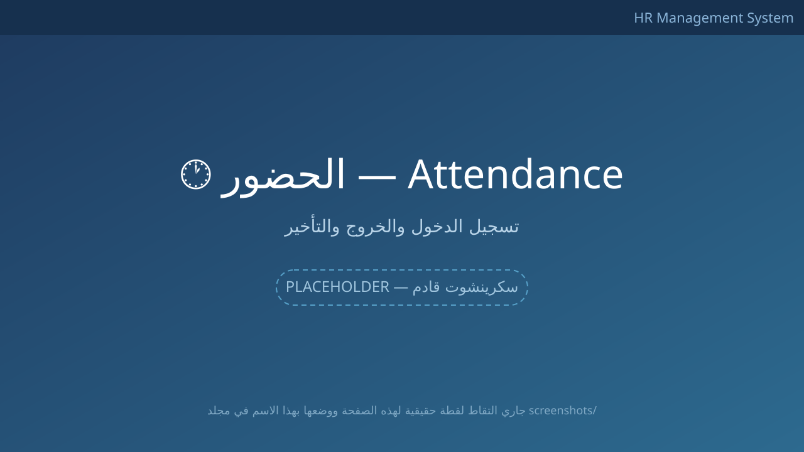
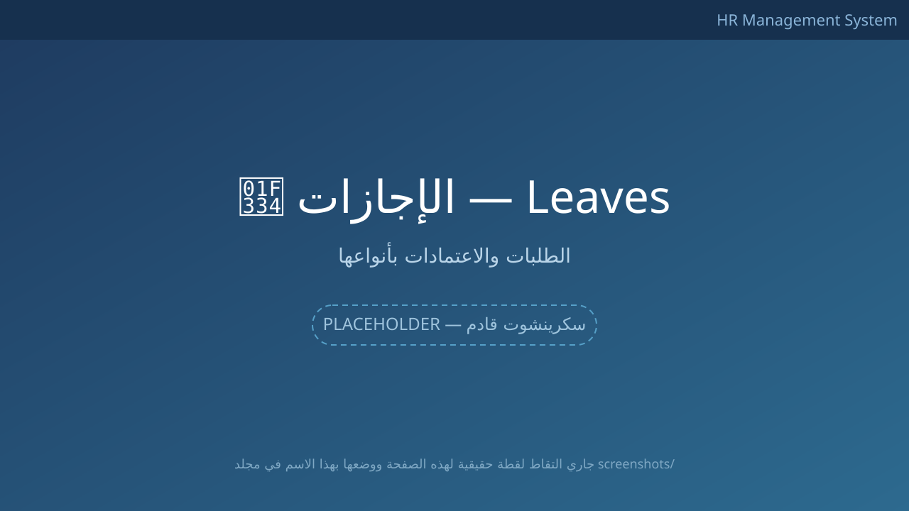
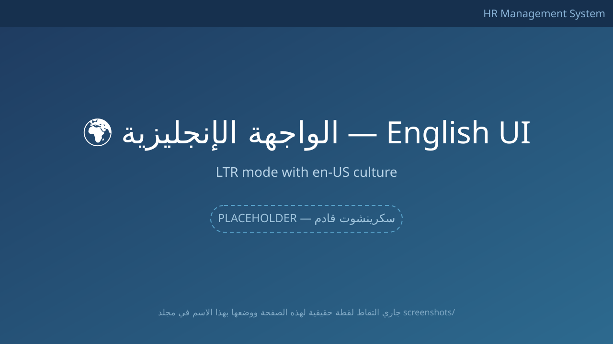

# نظام إدارة الموارد البشرية | HR Management System

<div dir="rtl">

نظام متكامل لإدارة الموارد البشرية مصمم خصيصاً لسوق العمل السعودي، بواجهة ثنائية اللغة (العربية RTL / الإنجليزية LTR)، يعتمد على **ASP.NET Core MVC** و**Entity Framework Core** مع مساعد ذكي بالذكاء الاصطناعي مدعوم من **Groq**.

[](https://dotnet.microsoft.com)
[](https://learn.microsoft.com/ef/core/)
[](https://www.microsoft.com/sql-server)
[](https://groq.com)
[](LICENSE)

</div>

---

<div dir="rtl">

## ✨ المميزات

### 🖥️ إدارة النظام
- **لوحة تحكم إحصائية** — مؤشرات فورية للموظفين، الحضور، الإجازات، والنسبة التشغيلية
- **إدارة الموظفين** — إضافة/تعديل/حذف مع بيانات كاملة (الأسماء ثنائية اللغة، الهوية/الإقامة، GOSI، IBAN، الراتب الأساسي)
- **إدارة الإدارات** — دعم أدوار المدير وربط الموظفين
- **الحضور والانصراف** — تسجيل بصمة الدخول/الخروج مع كشف التأخير
- **الإجازات** — طلب + اعتماد/رفض بأنواع متعددة (سنوية، مرضية، أمومة، حج، أبوة)

### 🤖 الذكاء الاصطناعي والأدوات
- **المساعد الذكي (AI Assistant)** — محادثة مدمجة في كل صفحة، يرد بالعربية عن سياسات الموظفين (السنوية، المرضية، العمل الإضافي، مكافأة نهاية الخدمة...) عبر [Groq API](https://console.groq.com/docs)
- **الآلة الحاسبة الشاملة** — ثلاث تبويبات:
  - آلة حاسبة عادية
  - حاسبة الرواتب والاستحقاقات
  - حاسبة أيام الإجازات (مع تحويل **هجري ← ميلادي** تلقائياً)

### 🌍 التدويل والأمان
- واجهة ثنائية اللغة: **العربية (افتراضية، RTL)** والإنجليزية (LTR) — تبديل فوري من رأس الصفحة
- نظام ثنائي اللغة على مستوى قاعدة البيانات (حقول `Ar`/`En` لكل كيان)
- مصادقة كاملة عبر **ASP.NET Core Identity** بـ 4 أدوار: `Admin` | `HR` | `Manager` | `Employee`
- المفاتيح الحساسة تُدار في `appsettings.Development.json` المُهمَل من Git 🔐

## 🛠️ التقنيات

| المجال | التقنية |
|--------|---------|
| الواجهة | ASP.NET Core 10 MVC, Razor, Bootstrap 5 (RTL), Font Awesome |
| الخلفية | C# / .NET 10, Entity Framework Core 10 |
| قاعدة البيانات | SQL Server 2022 (Code-First + Migrations) |
| الهوية والأمان | ASP.NET Core Identity |
| الذكاء الاصطناعي | Groq API (نموذج `openai/gpt-oss-20b`) |
| المحليّة | Localization & RequestLocalization (ar-SA / en-US) |

## 🏗️ بنية المشروع

```
HR.System.sln
├── src/
│   ├── HR.Domain/            # الكيانات والثوابت (بدون أي اعتماد تقني)
│   │   ├── Entities/         # Employee, Department, Attendance, LeaveRequest
│   │   ├── Enums/            # LeaveType, LeaveStatus, EmploymentStatus...
│   │   └── Common/           # BaseEntity (CreatedAt, UpdatedAt, IsDeleted)
│   │
│   ├── HR.Infrastructure/    # طبقة البيانات
│   │   ├── Data/
│   │   │   ├── ApplicationDbContext.cs
│   │   │   ├── Configurations/   # Fluent API configurations
│   │   │   └── Migrations/       # EF Core migrations
│   │   ├── Identity/         # ApplicationUser, AppRoles
│   │   └── Seed/             # DbSeeder (بيانات أولية + حساب المدير)
│   │
│   └── HR.Web/               # طبقة العرض
│       ├── Controllers/      # MVC + API (AiController)
│       ├── Views/            # Razor + Shared Layout
│       ├── ViewModels/       # Login, EmployeeForm, LeaveForm...
│       ├── Resources/        # ملفات الترجمة
│       └── wwwroot/          # CSS, JS (الحاسبة + الشات)
```

**نمط البناء:** Clean Architecture — كل اتجاه الاعتماد للداخل: `HR.Web → HR.Infrastructure → HR.Domain`

## 🚀 التثبيت والتشغيل

### المتطلبات
- [.NET 10 SDK](https://dotnet.microsoft.com/download/dotnet/10.0)
- SQL Server (Express أو أي إصدار) — أو عدّل `ConnectionStrings` بما يناسبك
- (اختياري) [Groq API Key](https://console.groq.com/keys) لتفعيل المساعد الذكي

### الخطوات

```bash
# 1. استنساخ المستودع
git clone https://github.com/ahmeedezz55/hr-management-system.git
cd hr-management-system

# 2. استعادة الحزم وبناء المشروع
dotnet restore HR.System.sln
dotnet build HR.System.sln

# 3. ضبط قاعدة البيانات (اتصال SQL Server في src/HR.Web/appsettings.json)
dotnet ef migrations add InitialCreate --project src/HR.Infrastructure --startup-project src/HR.Web --output-dir Data/Migrations
dotnet ef database update --project src/HR.Infrastructure --startup-project src/HR.Web

# 4. تشغيل (سيتولى الـ Seed تلقائياً للأدوار والإدارات وحساب المدير)
dotnet run --project src/HR.Web
```

ثُم افتح: **https://localhost:7188** (أو المنفذ الموضح في نافذة التشغيل)

### تفعيل المساعد الذكي 🔐
أنشئ الملف `src/HR.Web/appsettings.Development.json` (لن يُرسل للـ Git):

```json
{
  "Groq": {
    "ApiKey": "gsk_YourApiKeyHere"
  }
}
```

</div>

## 👥 الحسابات التجريبية | Demo Accounts

<div dir="rtl">

تُنشأ تلقائياً عند التشغيل الأول عبر `DbSeeder`:

</div>

| الدور | البريد الإلكتروني 📧 | كلمة المرور 🔑 | ملاحظات |
|------|---------------------|----------------|---------|
| **Admin (مدير النظام)** | `admin@hr.sa` | `Admin@123` | الوصول الكامل + مرتبط بموظف `EMP-1001` |

> ⚠️ **ملاحظة أمنية:** هذا الحساب للطَرَح **التطويري** فقط — غيّر كلمة المرور فور استخدامك لأي بيئة حقيقية. يمكن إنشاء مستخدمين إضافيين بأدوار `HR`/`Manager`/`Employee` من داخل النظام.

<div dir="rtl">

## 📸 Screenshots

لقطات الشاشة متوفرة في مجلد [`screenshots/`](screenshots/) — راجع [دليل التقاطها](screenshots/README.md):

| الصفحة | الصورة |
|--------|-------|
| لوحة التحكم | `screenshots/dashboard.png` ←  |
| تسجيل الدخول | `screenshots/login.png`  |
| المساعد الذكي | `screenshots/ai-assistant.png`  |
| الآلة الحاسبة | `screenshots/calculator.png`  |
| الموظفون | `screenshots/employees.png`  |
| الإدارات | `screenshots/departments.png`  |
| الحضور | `screenshots/attendance.png`  |
| الإجازات | `screenshots/leaves.png`  |
| الوضع الإنجليزي | `screenshots/english-view.png`  |

## 🗺️ خارطة الطريق

- [ ] كشوف الرواتب ومستحقات نهاية الخدمة
- [ ] تقارير PDF و Excel
- [ ] تفعيل إشعارات الـ Stream API لجعل المساعد الذكي الفوري (SSE)
- [ ] تقارير الإجازات بتقويم ميلادي/هجري
- [ ] API للتكامل الخارجي مع Swagger UI

## 📄 الترخيص

هذا المشروع مُرخَّص تحت رخصة MIT — راجع ملف [LICENSE](LICENSE).

## 📬 التواصل | Contact

- 👨‍💻 **أحمد عز** — [GitHub: ahmeedezz55](https://github.com/ahmeedezz55)

---

</div>

# ملخص سريع بالإنجليزية | Quick English Summary

A bilingual (Arabic RTL / English LTR) HR Management System built for the Saudi market with **ASP.NET Core 10 MVC + EF Core 10 + SQL Server**.

**Key features:** Employee & Department management · Attendance with late tracking · Leave workflows (annual, sick, maternity, Hajj, paternity) · Real-time stats dashboard · Embedded **AI HR Assistant** powered by [Groq](https://groq.com) · All-in-one widget (calculator, salary estimator, leave-days calculator with **Hijri→Gregorian** conversion) · 4 Identity roles (`Admin`, `HR`, `Manager`, `Employee`) · Localization with resource-based translations.

**Architecture** — Clean Architecture layering (`HR.Web → HR.Infrastructure → HR.Domain`) with Code-First migrations and seeded default admin `admin@hr.sa / Admin@123`.

**Security** — Secrets live only in git-ignored `appsettings.Development.json`; no credentials are committed to the repository.

---
*Made with ❤️ in Saudi Arabia — صُنع بحب في المملكة العربية السعودية*
