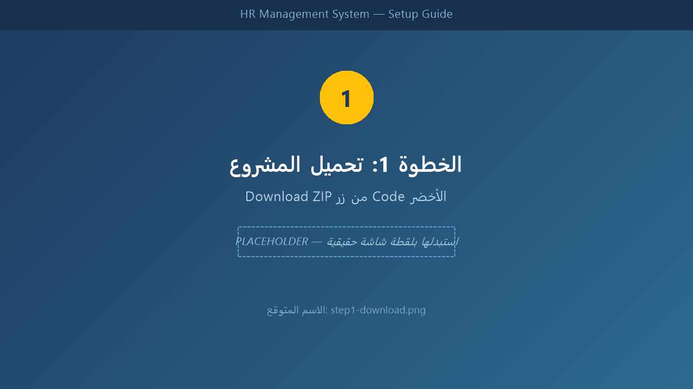
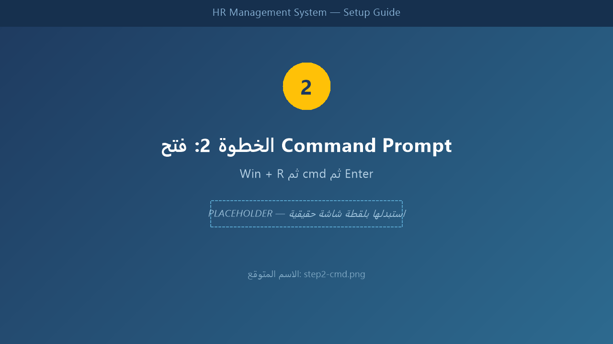
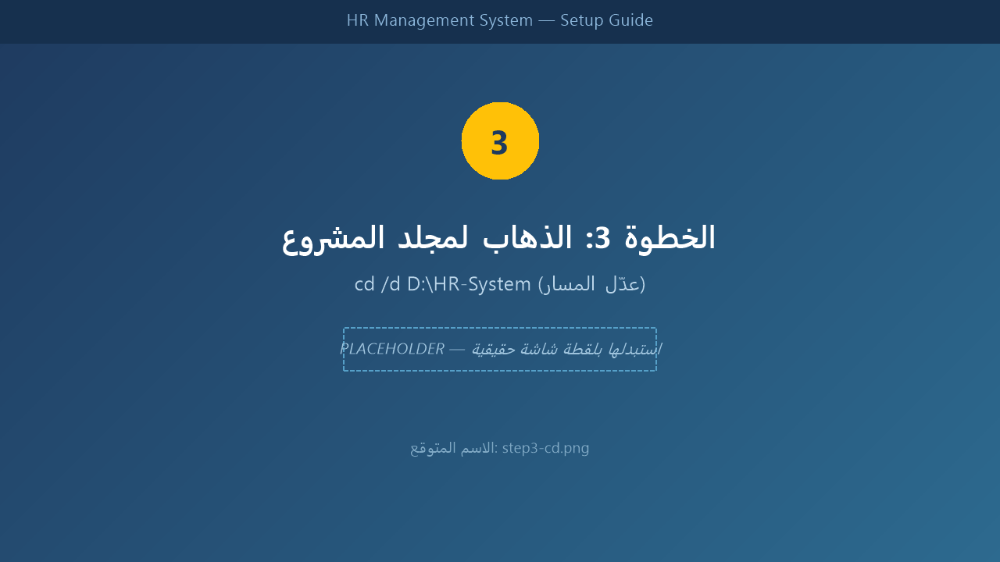
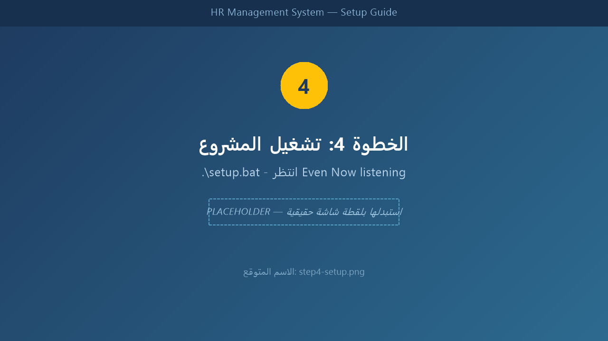
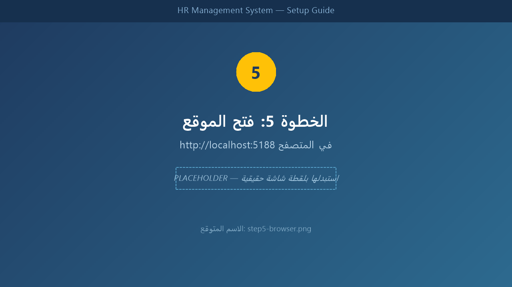
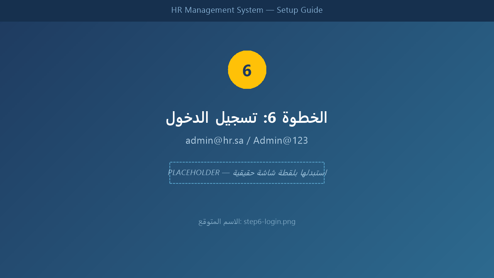

# نظام إدارة الموارد البشرية | HR Management System

<div dir="rtl">

نظام متكامل لإدارة الموارد البشرية مصمم خصيصاً لسوق العمل السعودي، بواجهة ثنائية اللغة (العربية RTL / الإنجليزية LTR)، يعتمد على **ASP.NET Core MVC** و**Entity Framework Core** مع مساعد ذكي بالذكاء الاصطناعي مدعوم من **Groq**.

[](https://dotnet.microsoft.com)
[](https://learn.microsoft.com/ef/core/)
[](https://www.microsoft.com/sql-server)
[](https://groq.com)
[](LICENSE)

**☁️ بضغطة زر واحدة — شغّل المشروع في متصفحك الآن بدون أي تثبيت:**

[](https://codespaces.new/ahmeedezz55/hr-management-system?quickstart=1)

</div>

---

<div dir="rtl">

## ⚡ Quick Start — التشغيل في 30 ثانية

### الطريقة الأسرع (Docker) 🐳

```bash
git clone https://github.com/ahmeedezz55/hr-management-system.git
cd hr-management-system
docker compose up --build
```

ثم افتح 👉 **http://localhost:8080** — بيانات الدخول: `admin@hr.sa` / `Admin@123`
> الـ Migrations والبيانات الأولية تُطبَّق تلقائياً عند الإقلاع — لا حاجة لأي خطوة إضافية.

### أو الطريقة التقليدية (سكريبت الإعداد) 💻

```bash
./setup.bat    # Windows
./setup.sh     # Linux / Mac   (chmod +x setup.sh أولاً)
```

### أو GitHub Codespaces (المتصفح مباشرة، بدون تثبيت أي شيء) ☁️

افتح المستودع → زر **Code** → تبويب **Codespaces** → **Create codespace** → وانتظر التجهيز ثم:

```bash
dotnet run --project src/HR.Web
```

راجع `.devcontainer/` للتفاصيل. لتفعيل المساعد الذكي في Codespaces ضع `GROQ_API_KEY` كمتغير بيئة على جهازك أو كـ Secret في المستودع.

> 💡 **Variable البيئية للمفتاح:** في كل الطرق أعلاه، مفتاح Groq يُقرأ من متغير البيئة `GROQ_API_KEY` (ملف `.env` مع Docker) — لا حاجة لتعديل أي ملف مُرتكب في Git. راجع `.env.example`.

## 📍 طرق التشغيل بالتفصيل

### 🗂️ اختر الطريقة المناسبة لك

| الطريقة | المستوى المطلوب | المميزات ✅ | العيوب ⚠️ |
|---------|----------------|-------------|-----------|
| 🐳 **Docker** | متوسط - متقدم | معزولة تماماً، لا تؤثر على النظام، خطوة واحدة | تحتاج تثبيت Docker Desktop |
| 💻 **Setup Script** | مبتدئ | سكريبت يتحقق من كل شيء تلقائياً، سريعة للتطوير اليومي | تحتاج .NET SDK و SQL Server على جهازك |
| ☁️ **Codespaces** | أي مستوى | لا تحتاج تثبيت أي شيء، تعمل من المتصفح | تحتاج إنترنت جيد، محدودة تحساباً (Codespaces) |

---

### 1️⃣ الطريقة الأولى: Docker 🐳 (الأسرع والأأنظف)

**📋 المتطلبات:**
- تثبيت [Docker Desktop](https://www.docker.com/products/docker-desktop) (اختر النسخة المناسبة لنظامك: Windows / Mac / Linux)
- بعد التثبيت، تأكد أن Docker Desktop **يعمل** (أيقونة الحوت 🐋 قرب الساعة)

**🪜 الخطوات خطوة بخطوة:**

1. افتح **Command Prompt**: اضغط `Win + R` → اكتب `cmd` → اضغط `Enter`
2. الصق الأوامر التالية واحداً تلو الآخر:

```cmd
git clone https://github.com/ahmeedezz55/hr-management-system.git
cd hr-management-system
docker compose up --build
```

3. ⏳ **انتظر 2-3 دقائق** — سترى في الشاشة:
   - تحميل صورة SQL Server 2022 ثم صورة التطبيق
   - ثم سطراً مشابهاً لـ:
   
   ```
   hr-web     | Now listening on: http://[::]:8080
   ```

4. 🌐 افتح المتصفح على: **http://localhost:8080**
5. 🔑 سجّل الدخول: `admin@hr.sa` / `Admin@123`

**📝 ملاحظات:**
- الـ **Migrations والبيانات الأولية تُطبَّق تلقائياً** عند الإقلاع الأول — لا توجد خطوات قاعدة بيانات يدوية.
- (اختياري) لتفعيل المساعد الذكي: انسخ `.env.example` إلى `.env` وضع مفتاح Groq فيه مرة واحدة:
  ```cmd
  copy .env.example .env
  ```
  ثم عدّل `GROQ_API_KEY` في الملف وأعد التشغيل.
- لإيقاف النظام: اضغط `Ctrl + C` في النافذة، ولحذف البيانات نهائياً: `docker compose down -v`

---

### 2️⃣ الطريقة الثانية: التشغيل المباشر 💻 (بدون Docker)

**📋 المتطلبات:**
- [.NET 10 SDK](https://dotnet.microsoft.com/download/dotnet/10.0) — السكريبت **يتحقق** من وجوده ويعطيك رابط التثبيت إذا لم يكن موجوداً
- SQL Server (Express أو LocalDB أو أي إصدار) — السكريبت **يتحقق** من الاتصال به أيضاً

**🪜 الخطوات خطوة بخطوة:**

1. افتح **Command Prompt**: `Win + R` → `cmd` → `Enter`
2. اكتب الأوامر (استبدل المسار بمسار المشروع على جهازك):

```cmd
cd /d D:\HR-System
.\setup.bat
```

> 📝 إذا لم يكن المشروع في `D:\HR-System`، استبدل المسار بالمسار الصحيح — مثلاً `cd /d C:\Users\YourName\hr-management-system`
> 
> 🍎 على **Linux/Mac**: `chmod +x setup.sh` مرة واحدة ثم `./setup.sh`

3. ✅ سيقوم السكريبت تلقائياً بـ:
   - ✅ التحقق من تثبيت .NET 10 SDK
   - ✅ التحقق من الاتصال بـ SQL Server
   - ✅ إنشاء `appsettings.Development.json` إن لم يوجد
   - ✅ تثبيت أداة `dotnet-ef` (إن لزم) وتطبيق الـ Migrations
   - ✅ بناء المشروع وتشغيله

4. ⏳ انتظر حتى تظهر:
   ```
   Now listening on: http://localhost:5188
   Now listening on: https://localhost:7188
   ```
5. 🌐 افتح المتصفح على: **http://localhost:5188** (أو **https://localhost:7188**)
6. 🔑 سجّل الدخول: `admin@hr.sa` / `Admin@123`

**📝 ملاحظات:**
- إذا ظهر خطأ اتصال بقاعدة البيانات: عدّل `ConnectionStrings` في `src/HR.Web/appsettings.json` بما يناسب نسخة SQL Server لديك.
- لتفعيل المساعد الذكي: ضع مفتاح Groq في `src/HR.Web/appsettings.Development.json` (الملف مُهمَل من Git تلقائياً).

---

### 3️⃣ الطريقة الثالثة: GitHub Codespaces ☁️ (المتصفح فقط — بدون أي تثبيت)

**🪜 الخطوات خطوة بخطوة:**

1. 📂 افتح المشروع على GitHub: [hr-management-system](https://github.com/ahmeedezz55/hr-management-system)
2. 🟩 اضغط زر **Code** الأخضر
3. 🗂️ اختر تبويب **Codespaces**
4. ▶️ اضغط **Create codespace on main**
5. ⏳ انتظر 2-5 دقائق حتى تجهز البيئة (سيبنى المشروع تلقائياً — .NET 10 و SQL Server يهيّآن داخل الحاوية)
6. 💻 سيفتح VS Code داخل المتصفح
7. 🖊️ افتح Terminal من القائمة أو بالاختصار `Ctrl` + `` ` ``
8. اكتب الأمر التالي:

```bash
dotnet run --project src/HR.Web
```

9. ⏳ انتظر حتى يظهر:
   ```
   Now listening on: http://localhost:5188
   ```
10. 🌐 سيظهر إشعار بسؤالك عن فتح المنفذ 5188 — اضغط **Open in Browser**، أو افتح الرابط المقترح في تبويب **Ports**

**📝 ملاحظات:**
- قاعدة البيانات تعمل داخل حاوية مرفقة تلقائياً — لا إعداد يدوي.
- لتفعيل المساعد الذكي: أضف Secretًا باسم `GROQ_API_KEY` في إعدادات المستودع (Settings → Secrets and variables → Codespaces) أو اضبطه كمتغير بيئة محلياً باسم `GROQ_API_KEY` قبل إنشاء الـ Codespace.
- البيانات تُحفظ داخل الـ Codespace نفسه — حذف الـ Codespace يحذف البيانات معه.

## 🎓 للمبتدئين تماماً (خطوة بخطوة مع الصور)

<div dir="rtl">

إذا لم تكن تعرف كيف تشغّل المشروع إطلاقاً، اتبع الخطوات التالية بالترتيب (6 خطوات فقط — 5 دقائق):

### 🖼️ الخطوة 1: تحميل المشروع

1. اضغط على الزر الأخضر **"Code"** في أعلى صفحة المشروع
2. اضغط **"Download ZIP"**
3. فك الضغط عن الملف في أي مكان على جهازك (مثلاً `D:\HR-System`)



### 🖼️ الخطوة 2: فتح Command Prompt

1. اضغط على زر **Windows** في الكيبورد
2. اكتب: `cmd`
3. اضغط **Enter**



### 🖼️ الخطوة 3: الذهاب لمجلد المشروع

في نافذة الـ Command Prompt اكتب:

```cmd
cd /d D:\HR-System
```

> ⚠️ **مهم**: استبدل `D:\HR-System` بالمسار الفعلي حيث فكّكت الضغط — أسهل طريقة: افتح المجلد في مستكشف الملفات، اضغط على شريط العنوان أعلى النافذة، انسخ المسار، والصقه في الأمر بدل `D:\HR-System`



### 🖼️ الخطوة 4: تشغيل المشروع

اكتب الأمر التالي واضغط Enter:

```cmd
.\setup.bat
```

⏳ انتظر حتى تظهر رسالة مشابهة لـ:

```
Now listening on: http://localhost:5188
```

> ⚠️ لا تغلق النافذة السوداء بينما المشروع يعمل — هي خادم الويب نفسه



### 🖼️ الخطوة 5: فتح الموقع

1. افتح المتصفح (Chrome أو Edge)
2. اكتب في شريط العنوان: `http://localhost:5188`
3. اضغط **Enter** 🎉



### 🖼️ الخطوة 6: تسجيل الدخول

| الحقل | القيمة |
|-------|--------|
| البريد الإلكتروني 📧 | `admin@hr.sa` |
| كلمة المرور 🔑 | `Admin@123` |

أدخل بيانات الدخول ثم اضغط زر تسجيل الدخول — وستنتقل مباشرة إلى لوحة التحكم 🎊



> 📸 الصور أعلاه حالياً **Placeholders** — استبدلها بلقطات شاشة حقيقية بنفس الأسماء في مجلد [`screenshots/setup-guide/`](screenshots/setup-guide/) (راجع الدليل داخله).

> 🎥 تفضل الفيديو على النص؟ راجع [`VIDEO_TUTORIAL.md`](VIDEO_TUTORIAL.md) — سيناريو فيديو توضيحي كامل بالتوقيتات (وسيُضاف رابط الفيديو عند نشره).

## ❓ الأسئلة الشائعة (FAQ)

### 🖥️ عام

**س: ماذا أفعل إذا ظهر خطأ "Port already in use"?**
**ج:** المنفذ مستخدَم بالفعل من برنامج آخر (غالباً نسخة قديمة من التطبيق تعمل في الخلفية). الحلول بالترتيب:
1. `Ctrl + C` على أي Command Prompt آخر شغّال فيه المشروع
2. أو أعد تشغيل الجهاز إذا لم تعرف مصدر البرنامج
3. أو بدّل المنفذ: في Docker غيّر `"8080:8080"` في `docker-compose.yml` (الجهة اليسرى فقط، مثلاً `"9080:8080"`) — وفي التشغيل المباشر عدّل `http://localhost:5188` داخل `src/HR.Web/Properties/launchSettings.json`

**س: ماذا أفعل إذا فشل الاتصال بقاعدة البيانات؟**
**ج:** بالترتيب حسب طريقتك:
- 🐳 **Docker**: تأكد أن حاوية SQL Server تعمل: `docker compose ps` — يجب أن تكون بحالة `(healthy)`، وللاستقصاء: `docker compose logs db`
- 💻 **تشغيل مباشر**: تأكد أن خدمة SQL Server تعمل — من قائمة Start افتح **Services** (`services.msc`) وتأكد أن `SQL Server (SQLEXPRESS)` بحالة `Running`
- عدّل الـ `ConnectionStrings` في `src/HR.Web/appsettings.json` إن كان اسم السيرفر/النسخة مختلفاً

**س: كيف أوقف المشروع؟**
**ج:** في نافذة الـ Terminal اضغط **`Ctrl + C`** — ولإيقاف Docker بالكامل (مع القاعدة): `docker compose stop`

**س: المساعد الذكي لا يعمل ويعرض "مفتاح Groq غير صحيح"?**
**ج:** المفتاح غير مضبوط. أضفه حسب طريقتك: `.env` على مسار المستودع (Docker) أو `appsettings.Development.json` (تشغيل مباشر) أو Secret باسم `GROQ_API_KEY` (Codespaces) — ثم أعد التشغيل. مفتاح مجاني من [Groq Console](https://console.groq.com/keys).

### 🗄️ البيانات

**س: أين يتم حفظ البيانات؟**
**ج:** في قاعدة بيانات **SQL Server** باسم `HRSystem`:
- 🐳 Docker: داخل Volume مستمر على جهازك (`hr-system_mssql_data`) — لا تُضيع عند إعادة التشغيل
- 💻 مباشرة: في SQL Server المثبّت على جهازك
- ☁️ Codespaces: داخل الـ Codespace نفسه — تُحذف مع حذف الـ Codespace

**س: كيف أفرّغ البيانات وبدء من الصفر؟**
**ج:** 🐳 Docker: `docker compose down -v` ثم `docker compose up --build` — 💻 مباشرة: احذف القاعدة `HRSystem` (من SSMS أو sqlcmd) ثم أعد تشغيل التطبيق وسيُبنى تلقائياً بالـ Seed.

## ✨ المميزات

### 🖥️ إدارة النظام
- **لوحة تحكم إحصائية** — مؤشرات فورية للموظفين، الحضور، الإجازات، والنسبة التشغيلية
- **إدارة الموظفين** — إضافة/تعديل/حذف مع بيانات كاملة (الأسماء ثنائية اللغة، الهوية/الإقامة، GOSI، IBAN، الراتب الأساسي)
- **إدارة الإدارات** — دعم أدوار المدير وربط الموظفين
- **الحضور والانصراف** — تسجيل بصمة الدخول/الخروج مع كشف التأخير
- **الإجازات** — طلب + اعتماد/رفض بأنواع متعددة (سنوية، مرضية، أمومة، حج، أبوة)

### 🤖 الذكاء الاصطناعي والأدوات
- **المساعد الذكي (AI Assistant)** — محادثة مدمجة في كل صفحة، يرد بالعربية عن سياسات الموظفين (السنوية، المرضية، العمل الإضافي، مكافأة نهاية الخدمة...) عبر [Groq API](https://console.groq.com/docs)
- **الآلة الحاسبة الشاملة** — ثلاث تبويبات:
  - آلة حاسبة عادية
  - حاسبة الرواتب والاستحقاقات
  - حاسبة أيام الإجازات (مع تحويل **هجري ← ميلادي** تلقائياً)

### 🌍 التدويل والأمان
- واجهة ثنائية اللغة: **العربية (افتراضية، RTL)** والإنجليزية (LTR) — تبديل فوري من رأس الصفحة
- نظام ثنائي اللغة على مستوى قاعدة البيانات (حقول `Ar`/`En` لكل كيان)
- مصادقة كاملة عبر **ASP.NET Core Identity** بـ 4 أدوار: `Admin` | `HR` | `Manager` | `Employee`
- المفاتيح الحساسة تُدار في `appsettings.Development.json` المُهمَل من Git 🔐

## 🛠️ التقنيات

| المجال | التقنية |
|--------|---------|
| الواجهة | ASP.NET Core 10 MVC, Razor, Bootstrap 5 (RTL), Font Awesome |
| الخلفية | C# / .NET 10, Entity Framework Core 10 |
| قاعدة البيانات | SQL Server 2022 (Code-First + Migrations) |
| الهوية والأمان | ASP.NET Core Identity |
| الذكاء الاصطناعي | Groq API (نموذج `openai/gpt-oss-20b`) |
| المحليّة | Localization & RequestLocalization (ar-SA / en-US) |

## 🏗️ بنية المشروع

```
HR.System.sln
├── src/
│   ├── HR.Domain/            # الكيانات والثوابت (بدون أي اعتماد تقني)
│   │   ├── Entities/         # Employee, Department, Attendance, LeaveRequest
│   │   ├── Enums/            # LeaveType, LeaveStatus, EmploymentStatus...
│   │   └── Common/           # BaseEntity (CreatedAt, UpdatedAt, IsDeleted)
│   │
│   ├── HR.Infrastructure/    # طبقة البيانات
│   │   ├── Data/
│   │   │   ├── ApplicationDbContext.cs
│   │   │   ├── Configurations/   # Fluent API configurations
│   │   │   └── Migrations/       # EF Core migrations
│   │   ├── Identity/         # ApplicationUser, AppRoles
│   │   └── Seed/             # DbSeeder (بيانات أولية + حساب المدير)
│   │
│   └── HR.Web/               # طبقة العرض
│       ├── Controllers/      # MVC + API (AiController)
│       ├── Views/            # Razor + Shared Layout
│       ├── ViewModels/       # Login, EmployeeForm, LeaveForm...
│       ├── Resources/        # ملفات الترجمة
│       └── wwwroot/          # CSS, JS (الحاسبة + الشات)
```

**نمط البناء:** Clean Architecture — كل اتجاه الاعتماد للداخل: `HR.Web → HR.Infrastructure → HR.Domain`

## 🚀 التثبيت والتشغيل

> 📖 **الطريقة الأسرع؟** راجع قسم [Quick Start](#-quick-start--التشغيل-في-30-ثانية) في أعلى الصفحة (Docker / Setup scripts / Codespaces).

### المتطلبات
- [.NET 10 SDK](https://dotnet.microsoft.com/download/dotnet/10.0)
- SQL Server (Express أو أي إصدار) — أو عدّل `ConnectionStrings` بما يناسبك
- (اختياري) [Groq API Key](https://console.groq.com/keys) لتفعيل المساعد الذكي

### الخطوات

```bash
# 1. استنساخ المستودع
git clone https://github.com/ahmeedezz55/hr-management-system.git
cd hr-management-system

# 2. استعادة الحزم وبناء المشروع
dotnet restore HR.System.sln
dotnet build HR.System.sln

# 3. ضبط قاعدة البيانات (اتصال SQL Server في src/HR.Web/appsettings.json)
dotnet ef migrations add InitialCreate --project src/HR.Infrastructure --startup-project src/HR.Web --output-dir Data/Migrations
dotnet ef database update --project src/HR.Infrastructure --startup-project src/HR.Web

# 4. تشغيل (سيتولى الـ Seed تلقائياً للأدوار والإدارات وحساب المدير)
dotnet run --project src/HR.Web
```

ثُم افتح: **https://localhost:7188** (أو المنفذ الموضح في نافذة التشغيل)

### تفعيل المساعد الذكي 🔐
أنشئ الملف `src/HR.Web/appsettings.Development.json` (لن يُرسل للـ Git):

```json
{
  "Groq": {
    "ApiKey": "gsk_YourApiKeyHere"
  }
}
```

</div>

## 👥 الحسابات التجريبية | Demo Accounts

<div dir="rtl">

تُنشأ تلقائياً عند التشغيل الأول عبر `DbSeeder`:

</div>

| الدور | البريد الإلكتروني 📧 | كلمة المرور 🔑 | ملاحظات |
|------|---------------------|----------------|---------|
| **Admin (مدير النظام)** | `admin@hr.sa` | `Admin@123` | الوصول الكامل + مرتبط بموظف `EMP-1001` |

> ⚠️ **ملاحظة أمنية:** هذا الحساب للطَرَح **التطويري** فقط — غيّر كلمة المرور فور استخدامك لأي بيئة حقيقية. يمكن إنشاء مستخدمين إضافيين بأدوار `HR`/`Manager`/`Employee` من داخل النظام.

<div dir="rtl">

## 📸 Screenshots

لقطات الشاشة متوفرة في مجلد [`screenshots/`](screenshots/):

### لوحة التحكم — Dashboard


### تسجيل الدخول — Login


### المساعد الذكي — AI Assistant


### الآلة الحاسبة — Calculator


### الموظفون — Employees


### الأقسام — Departments


### الإجازات — Leaves


## 🗺️ خارطة الطريق

- [ ] كشوف الرواتب ومستحقات نهاية الخدمة
- [ ] تقارير PDF و Excel
- [ ] تفعيل إشعارات الـ Stream API لجعل المساعد الذكي الفوري (SSE)
- [ ] تقارير الإجازات بتقويم ميلادي/هجري
- [ ] API للتكامل الخارجي مع Swagger UI

## 📄 الترخيص

هذا المشروع مُرخَّص تحت رخصة MIT — راجع ملف [LICENSE](LICENSE).

## 📬 التواصل | Contact

- 👨‍💻 **أحمد عز** — [GitHub: ahmeedezz55](https://github.com/ahmeedezz55)

---

</div>

# ملخص سريع بالإنجليزية | Quick English Summary

A bilingual (Arabic RTL / English LTR) HR Management System built for the Saudi market with **ASP.NET Core 10 MVC + EF Core 10 + SQL Server**.

**Key features:** Employee & Department management · Attendance with late tracking · Leave workflows (annual, sick, maternity, Hajj, paternity) · Real-time stats dashboard · Embedded **AI HR Assistant** powered by [Groq](https://groq.com) · All-in-one widget (calculator, salary estimator, leave-days calculator with **Hijri→Gregorian** conversion) · 4 Identity roles (`Admin`, `HR`, `Manager`, `Employee`) · Localization with resource-based translations.

**Architecture** — Clean Architecture layering (`HR.Web → HR.Infrastructure → HR.Domain`) with Code-First migrations and seeded default admin `admin@hr.sa / Admin@123`.

**Security** — Secrets live only in git-ignored `appsettings.Development.json`; no credentials are committed to the repository.

---
*Made with ❤️ in Saudi Arabia — صُنع بحب في المملكة العربية السعودية*
